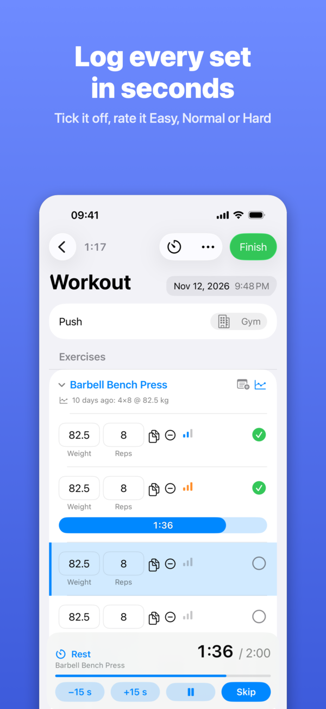
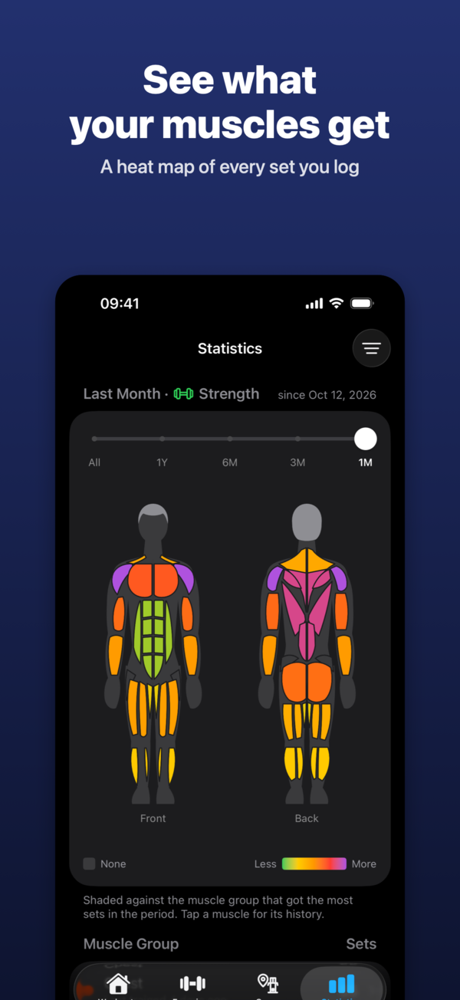
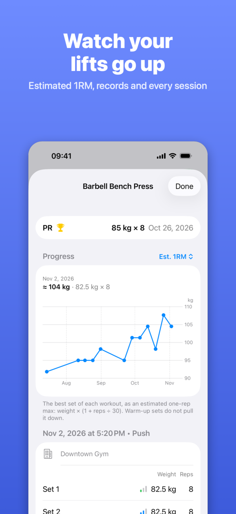
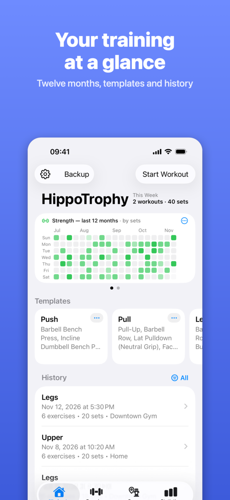
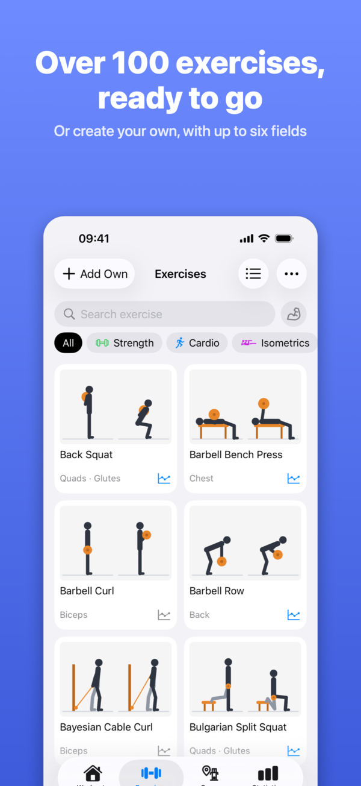
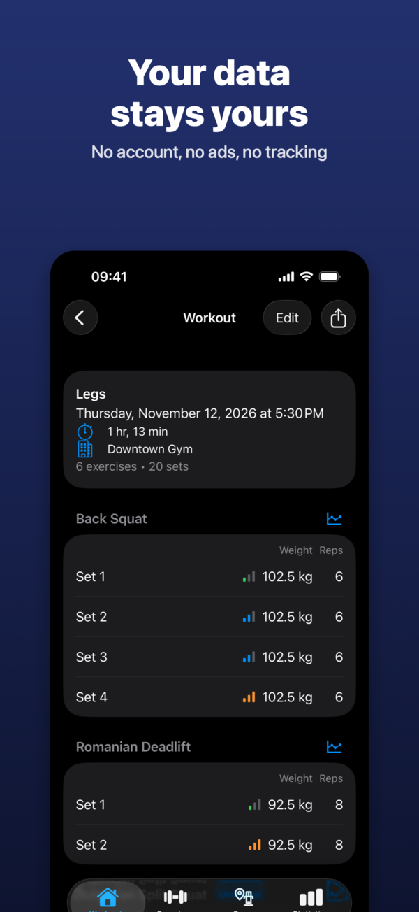

  

<h1 align="center">HippoTrophy</h1>

  <strong>A workout log for hypertrophy and strength training, native for iPhone.</strong> 
  No account, no ads, no tracking. Your data stays on your iPhone.

  
  
  
  

  
  
  

  
  
  

## What it does

**Log a workout**
- Weight and reps for every set, with what you did last time right under the exercise
- Rate each set as Easy, Normal or Hard, or by Reps in Reserve
- Supersets, one-sided exercises with left and right apart, machine-assisted dips and pull-ups
- A rest timer on the Lock Screen and in the Dynamic Island
- Templates for the workouts you repeat

**See your progress**
- Every exercise's history with a graph: estimated 1RM, max weight, volume or most reps
- Personal records, marked with a trophy
- A muscle heat map of the sets each muscle group got
- Twelve months of training at a glance

**Exercises**
- A catalog of over 100 exercises, each with its muscles and a pictogram of the movement
- Exercises of your own, with up to six fields and a photo

**Your data stays yours**
- Everything is stored on the device; the app makes no network requests
- Backups are files you export and import yourself
- Free, with no subscription, no in-app purchases and no ads

## Links

- [Support](https://dernanne.github.io/hippotrophy-web/support.html)
- [Privacy policy](https://dernanne.github.io/hippotrophy-web/datenschutz.html)

## Contributing

Issues are welcome. A pull request is accepted under two conditions, and
you confirm both by adding a `Signed-off-by: Your Name <email>` line to
each commit (`git commit -s`):

1. You wrote the contribution yourself, or have the right to submit it,
   and it is licensed under the GNU AGPLv3 like the rest of the code.
2. You grant Yannik Wölfl a non-exclusive, perpetual and irrevocable
   permission to distribute the contribution, changed or unchanged, as part
   of HippoTrophy on Apple's App Store and TestFlight under Apple's terms.

## License

Copyright © 2026 Yannik Wölfl

Everything in this repository is licensed under the
[GNU Affero General Public License v3.0 only](LICENSE)
(SPDX: `AGPL-3.0-only`): the source code, the exercise catalog, the
pictograms and other images, the documentation and the test data.

The one exception is the app's identity: the name HippoTrophy, the app icon
(`HippoTrophy/Resources/Assets.xcassets/AppIcon.appiconset`, also shown at
the top of this page as `docs/icon.png`) and the hippo
(`HippoTrophy/Resources/Assets.xcassets/ReportAppMark.imageset`). They are
not licensed under the AGPL; under section 7(e) of the license, no rights to
them are granted. All rights reserved. A version you distribute needs a
name and an icon of its own.
